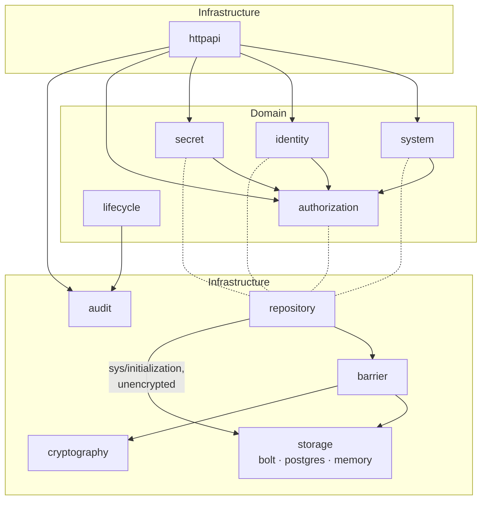
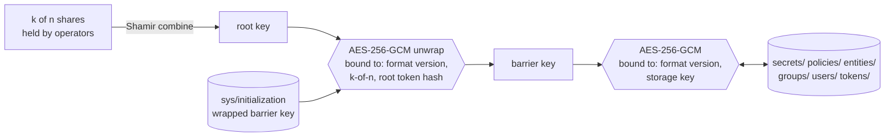
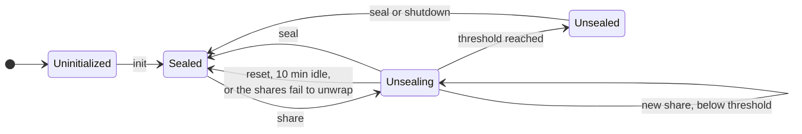
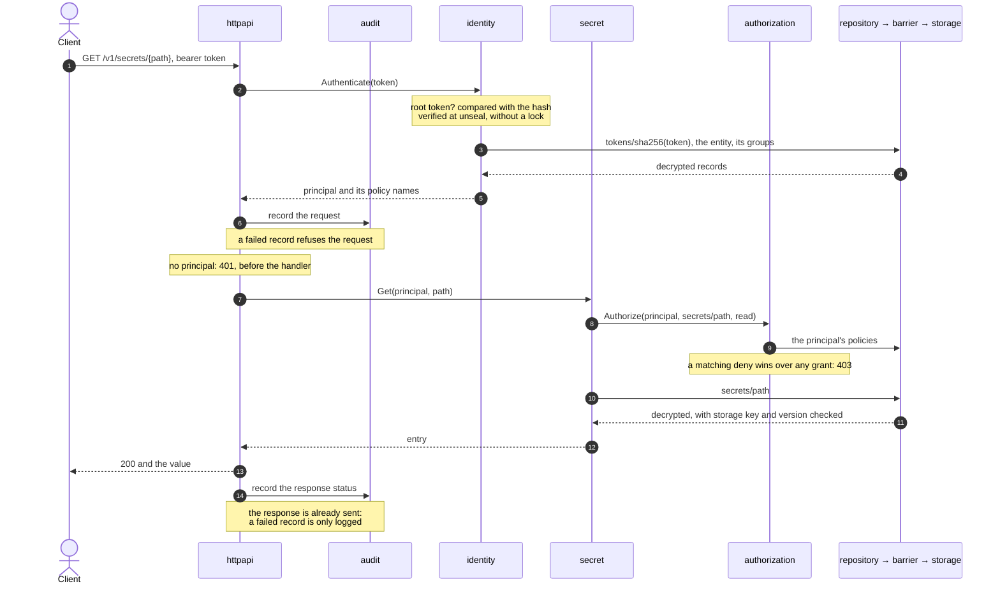

# seal-gate

A secrets-management service with Shamir-based unsealing, written in Go as a
bachelor's thesis project and loosely modelled on HashiCorp Vault.

Every value is encrypted before it reaches storage, under a key that is itself
stored only encrypted, by a root key that is never stored. At initialization
the root key is split into shares with Shamir's secret sharing. Every start
leaves the service sealed until a threshold of those same shares is handed in.
Once unsealed, it stores and generates secrets, controls access to them with
path-based policies over entities, groups and tokens, expires and rotates them
on a schedule, and writes an audit record of every request to an API route.

Built test-first: every behaviour began as a failing test, and code and its
tests landed together.

## Requirements

- Go, the version in [go.mod](go.mod).
- Optional: a PostgreSQL server, for the `postgres` storage backend and its
  tests. The default backend, bolt, is an embedded file and needs nothing.

## Running

Build and start the server. It listens on `127.0.0.1:8080`, stays in the
foreground, and writes its database and audit log to the working directory:

```sh
go build -o seal-gate ./cmd/seal-gate
./seal-gate
```

A new server is uninitialized and sealed. `POST /v1/sys/init` returns the
unseal shares and the root token, once; `POST /v1/sys/unseal` takes the shares
one at a time. The whole HTTP API is in [api/openapi.yaml](api/openapi.yaml).

### Configuration

All settings live in one YAML file. Without `-config`, the server runs with
[internal/config/default.yaml](internal/config/default.yaml), built into the
binary; it lists every field. A file passed with `-config` replaces it whole,
and is strict: a missing or unknown field, a wrong type or a missing file stops
the server at startup.

```sh
cp internal/config/default.yaml seal-gate.yaml   # then edit
./seal-gate -config seal-gate.yaml
```

The Postgres connection URL comes from the environment instead,
`SEAL_GATE_STORAGE_URL`, so the database password never sits in a file. It is
read only when `storage.type` is `postgres`:

```sh
SEAL_GATE_STORAGE_URL='postgres://seal:<password>@db.example:5432/seal'
```

### Tests and benchmarks

```sh
go test ./...
go test -run '^$' -bench . -benchmem ./...
```

The Postgres tests and benchmarks need a server, named by
`SEAL_GATE_POSTGRES_URL`, and skip without it. Each test gets its own schema,
so one database serves them all:

```sh
docker run -d --name seal-gate-pg -e POSTGRES_HOST_AUTH_METHOD=trust -p 127.0.0.1:5432:5432 postgres:18
export SEAL_GATE_POSTGRES_URL='postgres://postgres@localhost:5432/postgres?sslmode=disable'
```

## Architecture

The code is split into domain modules, which hold the rules, and
infrastructure, which they reach only through interfaces they declare
themselves. Infrastructure may import a domain module, never the reverse.

**Domain** (under `internal/`):

- `system`: init, seal and unseal, and the lifetime of the active key.
- `identity`: entities, groups, users, passwords and tokens; who is calling.
- `authorization`: path-based policies; what the caller may do.
- `secret`: storing, generating and rotating secrets.
- `lifecycle`: the background worker that expires and rotates on schedule.

**Infrastructure:**

- `httpapi`: routing, JSON, authentication middleware and error mapping.
- `barrier`: the encryption boundary; everything below it is ciphertext.
- `repository`: the one implementation of every domain repository.
- `storage`: the key-value contract, with `bolt`, `postgres` and `memory`
  backends.
- `cryptography`: AEAD, Shamir, key wrapping, the key holder and password
  hashing.
- `audit`: events, the fan-out recorder, and the file sink.
- `config`, and `app`, the composition root that wires everything together.

An arrow points from the importer to what it imports. A dotted line is
`repository` implementing the interfaces a domain module declares for its
storage; nothing in the domain imports it back. `app` imports every package
and is left out.



### Key hierarchy

The root key exists only while an unseal combines it, and the barrier key only
while the service is unsealed. Both AES-GCM steps authenticate additional data,
so a ciphertext cannot be moved to another storage key or relabelled with
another version. Nothing binds it to a revision, though: an older ciphertext
put back at the same key still decrypts, so the backend can roll a value back.



### Seal lifecycle

Shares are buffered in memory and checked only together, once the threshold is
reached, so a bad share is found only then. A restart, like a seal, loses the
buffer and the key.



## Communication

Reading a secret, from the HTTP layer down to storage and back. Every
authenticated route shares the first half: identify, audit the request, then
refuse it without a principal. The rest is the route's own; most authorize
against their resource as the secret service does here, but the token routes
under `/v1/auth/token` act only on the presented token. Every read below
`repository` goes through the barrier, so while sealed it fails with 503.



## Algorithms

| Purpose | Algorithm | Notes |
|---|---|---|
| Splitting the root key | Shamir's secret sharing over GF(2⁸) | Written by hand. One polynomial per byte; field multiplication is branch-free and table-free, so its timing does not depend on the key. |
| Encrypting stored values | AES-256-GCM | Each ciphertext is bound to its storage key and format version as additional data, so it cannot be moved or relabelled. |
| Wrapping the barrier key | AES-256-GCM under the root key | The seal configuration and root token hash are bound as additional data. |
| Hashing passwords | argon2id, m = 19 MiB, t = 2, p = 1 | Stored as PHC strings, which carry their own parameters. An unknown user is checked against a dummy hash, so it costs the same as a wrong password. At most one hash runs per usable CPU; the rest wait. |
| Storing tokens | SHA-256 | Tokens are 32 random bytes; only their hash is stored. |

Keys, shares, tokens and secret values are cleared from memory once used.
That is best-effort: `encoding/json` and `net/http` keep buffers of their own
that no caller can reach, and the garbage collector may copy a slice before
it is cleared.

## Extension points

Each one is an interface with a conformance test or a registry, chosen in the
composition root or the configuration file:

- **Storage backends** implement `storage.Backend` (get, put, delete, list by
  prefix) and pass the shared conformance suite in `storage/conformance`. The
  backend never sees plaintext, so it needs no security of its own.
- **Ciphers** are registered by name in `cryptography` and chosen with
  `crypto.aead_algorithm`. Stored values carry a format version byte.
- **Audit sinks** implement `audit.Sink`. Each is listed in `audit.sinks`,
  either required (a failed write refuses the request) or best effort, with
  its own timeout. A file sink with `sync: true` flushes each record to disk
  before the request goes on, at one `fsync` per record, two per request.
- **Password hash parameters** can change without invalidating stored hashes,
  since each hash records the parameters it was made with.
- **Login methods** issue tokens through the same token service as password
  login, so a new method only has to prove an identity.

### What the benchmarks say

Measured on an AMD Ryzen 7 7800X3D under Windows 11, Postgres running locally:

| Operation | Time | Memory |
|---|---|---|
| Login (any outcome) | 13.0 ms | 19 MB |
| Unseal, end to end | 79 µs | 38 KB |
| Read a secret as root, end to end | 27 µs | 17 KB |
| Read a secret as an entity, end to end | 35 µs | 25 KB |
| Barrier put / get (memory backend) | 0.88 / 0.81 µs | 4.8 / 3.6 KB |
| AES-256-GCM, 64 KiB | 13.5 µs (4.9 GB/s) | — |
| Shamir split / combine, 3 shares, threshold 2 | 3.4 / 1.2 µs | — |
| Shamir split / combine, 255 shares, threshold 128 | 20.8 / 1.5 ms | — |
| bolt put / get | 1.7 ms / 0.42 µs | — |
| postgres put / get | 1.4 / 0.30 ms | — |

What they point to:

- **Encryption is not the bottleneck.** The barrier adds under a microsecond
  over the backend, and storage dominates everything else: a durable write
  costs about 1.5 ms on either disk-backed backend, three orders of magnitude
  more than encrypting it. Batching writes would be the first improvement for
  write-heavy use.
- **Policy evaluation is the cost of not being root.** An entity's read takes
  a third longer and twice the allocations, because its policies and groups
  are read and decrypted from storage on every request. An in-memory cache
  of policies, invalidated on write, would close most of that gap.
- **Login is deliberately expensive.** Almost all of its 13 ms and 19 MB is
  argon2id, and an unknown user costs the same as a known one, so timing does
  not reveal which usernames exist. The memory is the risk: concurrent logins
  multiply it, so at most one hash runs per usable CPU and further logins wait
  for a slot, or until their request ends. Peak memory then follows the CPU
  count, not the traffic; in a container, Go reads the CPU count from its
  limit. Limiting attempts per client address is left to a reverse proxy.
- **Shamir costs nothing at realistic sizes.** Unseal is far from any limit
  even at the maximum of 255 shares; the byte-wise, constant-time field
  arithmetic could be replaced by lookup tables for speed, at the price of
  key-dependent memory access.
